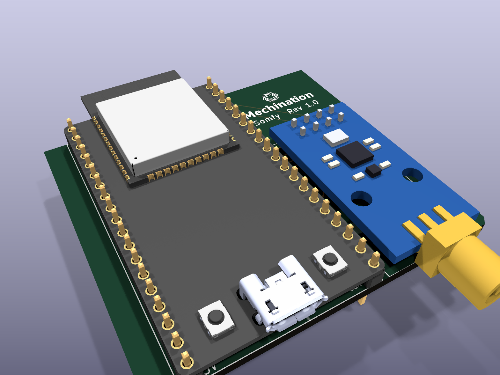
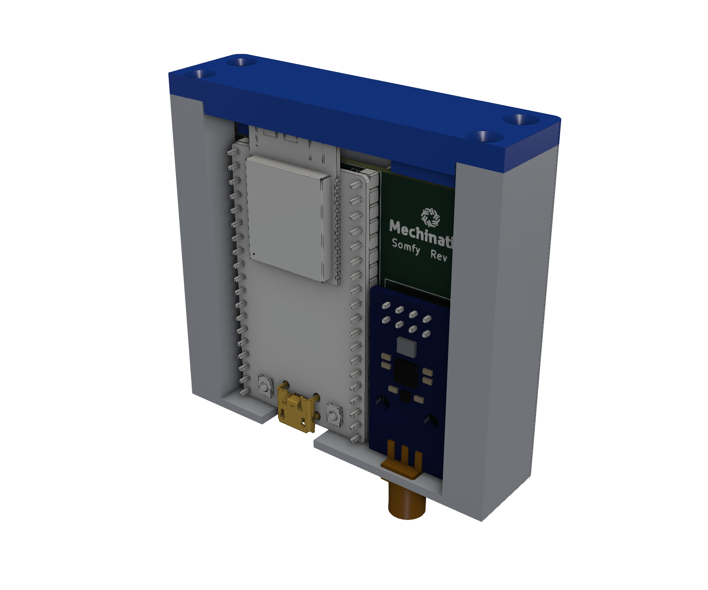
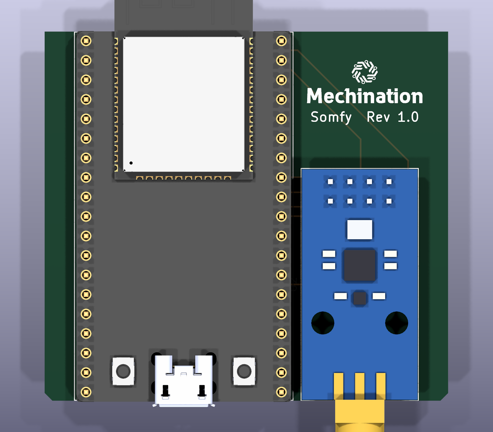

# Somfy RTS radio board

A carrier board and slide-in case for an [ESPSomfy RTS](https://github.com/rstrouse/ESPSomfy-RTS)
controller: an ESP32-DevKitC (ESP32_Core_board_V2) plus an Ebyte E07-M1101D-SMA CC1101
433 MHz module. Board revision 1.0, by Mechination.

<p align="center">
  
  
</p>

## Wiring

| CC1101 (E07) | ESP32   | Notes |
|--------------|---------|-------|
| GDO0         | GPIO13  | ESPSomfy **TX pin** |
| GDO2         | GPIO4   | ESPSomfy **RX pin** - set this to **4** (the ESPSomfy default is 12) |
| CSN          | GPIO5   | |
| SCK          | GPIO18  | |
| MOSI         | GPIO23  | |
| MISO         | GPIO19  | |
| VCC / GND    | 3V3 / GND | |

GDO2 uses GPIO4 rather than ESPSomfy's suggested GPIO12 because GPIO12 is a boot strapping
pin on the ESP32.

The E07 has a standard **SMA female** jack: use a **433 MHz** antenna with an SMA *male* plug
(not RP-SMA, and not a 2.4 GHz Wi-Fi antenna).

## Layout

| Path | What it is |
|------|------------|
| `Somfy.kicad_pro` / `.kicad_sch` / `.kicad_pcb` | KiCad 10 project |
| `Somfy.kicad_sym`, `Somfy.pretty/`, `3dshapes/` | Project library: ESP32-DevKitC symbol, footprint (1.0 mm holes) and 3D model |
| `cc1101-e07-kicad/` | E07-M1101D-SMA symbol, footprint and 3D model |
| `branding/` | Mechination logo prepared for silkscreen |
| `case/` | 3D-printed slide-in case (build123d) |
| `images/` | Board renders for this README (`kicad-cli pcb render`) |

All libraries are project-local (`sym-lib-table`, `fp-lib-table` use `${KIPRJMOD}`); only KiCad's
standard `power` symbols come from the KiCad install.

### ESP32-DevKitC 3D model (not included)

The DevKitC 3D model is a vendor model that can't be redistributed, so it isn't in this
repository. The board still opens and fabricates without it; it is only needed for KiCad's 3D view
and for the case fit checks.

1. Download the STEP model for **ESP32-DEVKITC-32D** from
   [SnapEDA](https://www.snapeda.com/parts/ESP32-DEVKITC-32D/Espressif%20Systems/view-part/) or
   [DigiKey](https://www.digikey.com/en/models/9356990).
2. Save it as `3dshapes/ESP32-DevKitC-32D.step`. The footprint already places it (rotate X -90,
   offset 12.7 / -19.8 mm).
3. Export the board for the case scripts (from the project folder):

   ```sh
   kicad-cli pcb export step --user-origin 54.102x106.3244mm --subst-models \
     --include-silkscreen --include-soldermask -f -o case/Somfy-pcb.step Somfy.kicad_pcb
   ```

Without `case/Somfy-pcb.step` the case still builds and views; the board-fit checks are skipped.

## PCB



- 2-layer, 52.4 x 48.1 mm, 1.6 mm FR4. Bottom layer is a ground pour.
- The side edges have 2.5 mm copper-free rails (rule-area keepouts) that slide into the case grooves.
- The ESP32-DevKitC is soldered directly to the board (male headers into 1.0 mm holes).
- Board setup uses JLCPCB's 0.3 mm copper-to-edge minimum. ERC and DRC are clean apart from
  small silkscreen labels inherited from the Espressif footprint.
- Fabrication files are exported with the JLCPCB plugin into `jlcpcb/` (not tracked in git).

## Case

A two-part case printed in nylon: the board slides down grooves in the body, USB and SMA come out
through the bottom wall, and a lid with four countersunk **M2.5 x 10 mm** screws closes the top.
Clearances are sized for JLC3DP **MJF PA12** (about +/-0.3 mm); every wall on the lid is at least 2 mm.

Everything is driven by [uv](https://docs.astral.sh/uv/) - each script declares its own
dependencies, so there is nothing to install or activate:

```sh
uv run case/view.py         # live 3D view in the browser; rebuilds whenever make_case.py is saved
uv run case/make_case.py    # build the parts -> case/SomfyCase-{body,lid}.{step,stl}
uv run case/check_case.py   # insertion sweep, measurements vs board, wall thickness, overhangs, validity
uv run case/render_case.py  # PNG renders into case/renders/ (needs F3D: brew install f3d)
```

`make_case.py` holds every dimension as a named setting at the top. The case is checked against
`case/Somfy-pcb.step` (see above); re-export it after changing the board.

Upload `case/SomfyCase-body.step` and `case/SomfyCase-lid.step` to JLC3DP. For printing at home,
print the body standing on its USB/SMA wall and the lid face down; setting `CSK_RELIEF = 0.3` in
`make_case.py` adds a small step at the countersinks to absorb first-layer squash.
